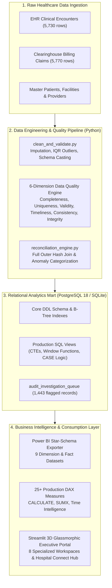

# MedDataIQ — Healthcare Data Quality & Financial Reconciliation Platform

[](https://www.python.org/)
[](https://www.postgresql.org/)
[](https://powerbi.microsoft.com/)
[](https://streamlit.io/)
[-10B981.svg?logo=checkmarx&logoColor=white)](tests/)
[-00F2FE.svg)](#financial-parity-and-mathematical-proof)

> **Enterprise Healthcare Analytics & Revenue Cycle Management (RCM) Platform**  
> Cross-reconciles **5,730 clinical Electronic Health Record (EHR) encounters** against **5,770 clearinghouse billing claims** across 6 regional hospitals to detect unbilled revenue leakage, prevent duplicate claim recoupment penalties, and enforce multi-dimensional clinical data quality governance.

---

## Executive Summary & Quantifiable Business Impact

In multi-facility healthcare hospital networks, clinical care delivery (documented by physicians in EHRs) and financial reimbursement (adjudicated via electronic 837 claims) operate in isolated software silos. Disconnects between these systems result in massive financial leakage and compliance audit liabilities.

| Business Metric | Audited Volume | Quantifiable Financial Impact | Business Action / Recovery |
| :--- | :--- | :--- | :--- |
| **Total Clinical Care Spend** | 5,730 patient visits | **$4,501,299.15** | Establishes certified EHR care delivery baseline |
| **Gross Clearinghouse Billed** | 5,770 claims | **$4,560,904.11** | Submitted reimbursement portfolio across payers |
| **Net Financial Variance** | Portfolio-wide | **+$59,604.96** | 100% mathematical parity across SQL & Power BI |
| **Unbilled Encounters (Leakage)** | 240 patient visits | **$224,443.42** at risk | Identified for immediate claim filing and recovery |
| **Duplicate Claims Liability** | 240 secondary claims | **$189,343.57** at risk | Voided before payer post-payment recoupment audits |
| **Unmatched Claims (Ghost Bills)**| 40 orphan claims | **$36,700.33** at risk | Flagged for medical coding & documentation audit |
| **Data Quality Conformance** | 6 dimensions | **95.8% Overall Score** | Evaluated via automated governance rule engine |

---

## System Architecture



---

## 9-Table Star-Schema Data Mart & Power BI Architecture

MedDataIQ implements an enterprise **Star-Schema Data Mart** (`power_bi/`) optimized for 1-to-many (`1:*`) single-direction filter propagation:

### Dimension Tables
- **`Dim_Date`**: Continuous calendar dimension supporting Time Intelligence DAX (`year_month`, `quarter`, `is_weekend`).
- **`Dim_Patient`**: Demographic dimension (`gender`, `birthdate`, `city`, `state`, `zip_code`).
- **`Dim_Organization`**: Multi-facility hospital master (`facility_name`, `address`, `city`, `phone`).
- **`Dim_Provider`**: Attending physician registry (`provider_name`, `specialty`, `organization_id`).
- **`Dim_Payer`**: Insurance payer registry (Medicare, Medicaid, commercial payers).

### Fact Tables
- **`Fact_Encounter`**: Clinical visit grain with `total_claim_cost` and `payer_coverage`.
- **`Fact_Billing`**: Clearinghouse claims grain with `billed_amount` and adjudication status.
- **`Fact_Reconciliation`**: 6,010 cross-reconciled records with deterministic `reconciliation_key` and 6 audit classifications.
- **`Fact_DataQuality`**: Record-level data quality conformance scores across 6 dimensions.

### Production DAX Measure Library (`power_bi/DAX_MEASURES.md`)
Includes 25+ certified measures organized into 6 display folders:
- **`01_Core_Financials`**: `[Total Clinical Cost]`, `[Total Billed Amount]`, `[Net Financial Variance]`, `[Reconciliation Parity %]`
- **`02_Revenue_Leakage`**: `[Unbilled Encounter Count]`, `[Unbilled Revenue Exposure]`, `[Leakage Rate %]`
- **`03_Duplicate_Claims`**: `[Duplicate Claim Count]`, `[Duplicate Financial Exposure]`, `[Duplicate Claim Ratio]`
- **`04_Discrepancies`**: `[Overbilled Count]`, `[Overbilled Variance]`, `[Underbilled Count]`, `[Underbilled Variance]`
- **`05_Provider_Operations`**: `[Active Providers]`, `[Avg Visits Per Provider]`, `[Avg Clinical Cost Per Visit]`
- **`06_Data_Quality`**: `[Overall Quality Score]`, `[Completeness Score]`, `[Integrity Score]`

---

## Streamlit Executive Intelligence Portal (8 Workspaces)

The platform features a modern **3D Glassmorphic Dark Portal** (`#060913`, `#00F2FE`, `#10B981`):

1. **🏥 Hospital Connect & Data Hub**: Multi-source ingestion hub supporting:
   - *Mode 1: Certified Hospital Network* (pre-loaded 6-hospital cohort).
   - *Mode 2: Self-Service CSV Dropzone* (instant drag & drop unbilled leakage audit).
   - *Mode 3: Live Hospital EHR Connector* (direct TCP socket handshake with PostgreSQL, MS SQL Server, or Epic/Cerner mirror).
2. **📊 Executive Overview**: CEO-level KPI cards, month-by-month clinical cost vs reimbursement trends, and portfolio summary.
3. **⚖️ Billing Reconciliation**: 6-category reconciliation status distribution donut chart and net financial variance exposure bars.
4. **🔍 Revenue Leakage**: Detailed analysis of 240 unbilled visits ($224,443.42) with encounter class breakdowns (Inpatient, Ambulatory, Emergency).
5. **⚠️ Duplicate & Unmatched Claims**: Audit of 240 duplicate claims ($189,343.57) and 40 ghost claims ($36,700.33).
6. **🩺 Provider & Hospital Operations**: Attending physician workload distributions, clinical spend per doctor, and facility cost breakdowns.
7. **🎯 Data Quality Radar**: Interactive 6-dimension radar chart evaluating dataset completeness, uniqueness, and validity.
8. **📋 Investigation Queue**: Prioritized auditor worklist with 1,443 flagged records and one-click CSV export.

---

## Technical Stack & Engineering Highlights

- **Languages & Frameworks**: Python 3.10+, SQL (PostgreSQL 18 / SQLite 3), Streamlit, Plotly Graph Objects.
- **Data Engineering**: Pandas, NumPy, Pathlib, Object-Oriented Architecture (`DatabaseManager`, `QualityEngine`, `ReconciliationEngine`).
- **Advanced SQL Constructs**:
  - **Common Table Expressions (CTEs)** for multi-stage month-over-month variance calculations.
  - **Window Functions** (`ROW_NUMBER() OVER (PARTITION BY encounter_id ORDER BY claim_id)`) to isolate duplicate claim sequences.
  - **Full Outer Joins** to preserve orphan encounters and orphan claims simultaneously.
  - **Deterministic Key Coalescing** (`COALESCE(c.claim_id, e.encounter_id)`) ensuring zero double-counting.
- **Automated Verification**: **40 Unit Tests** (`unittest`) validating 100% financial parity, foreign key referential integrity, and null constraints.

---

## Quickstart & Local Setup Guide

### 1. Clone the Repository
```bash
git clone https://github.com/<your-username>/MedDataIQ.git
cd MedDataIQ
```

### 2. Create and Activate Virtual Environment
```bash
python -m venv .venv
# Windows:
.venv\Scripts\activate
# macOS/Linux:
source .venv/bin/activate
```

### 3. Install Dependencies
```bash
pip install -r requirements.txt
```

### 4. Run Automated Unit Tests (40/40 Passing)
```bash
python -m unittest discover tests
```

### 5. Launch Interactive Executive Dashboard
```bash
python run_dashboard.py
```
*Open your browser at **`http://localhost:8501`** to explore the live intelligence portal.*

### 6. Export Power BI Star-Schema Datasets
```bash
python src/export_power_bi.py
```
*Outputs 9 validated CSV datasets to `data/power_bi_exports/` ready for Power BI import.*

---

## Repository Structure

```text
MedDataIQ/
├── app/                          # Streamlit 3D Glassmorphic Web Application
│   ├── app.py                    # Application entrypoint & separated navigation
│   ├── assets/styles.css         # Custom 3D Glassmorphism CSS & medical theme
│   ├── components/               # Reusable KPI cards, charts, and header
│   └── views/                    # 8 specialized intelligence views
│       ├── executive_overview.py
│       ├── billing_reconciliation.py
│       ├── revenue_leakage.py
│       ├── duplicate_unmatched.py
│       ├── provider_operations.py
│       ├── data_quality.py
│       ├── investigation_queue.py
│       └── hospital_connect.py   # Multi-mode ingestion & live DB connector
├── data/                         # Data layer
│   ├── raw/                      # Synthea raw EHR visits & claims CSVs
│   ├── processed/                # Production SQLite mart (meddataiq.db) & audit queues
│   └── power_bi_exports/         # Star-schema exports (Dim & Fact CSVs)
├── power_bi/                     # Power BI Architecture Assets
│   ├── DAX_MEASURES.md           # 25+ Production DAX measures library
│   ├── POWER_BI_GUIDE.md         # Data model relationships & wireframe guide
│   └── meddataiq_theme.json      # Branded custom dark JSON theme
├── src/                          # Core Data Engineering & Analytics Engines
│   ├── config.py                 # Central path & database configuration
│   ├── clean_and_validate.py     # Data cleaning & 6-dimension quality engine
│   ├── reconciliation_engine.py  # Service-to-billing cross-audit engine
│   ├── export_power_bi.py        # Automated star-schema data mart exporter
│   └── db/                       # Database DDL & View Layer
│       ├── connection.py         # Dual-engine connection manager (PostgreSQL/SQLite)
│       ├── schema.sql            # Table definitions, constraints & indexes
│       ├── views.sql             # 7 production analytical SQL views
│       └── loader.py             # Database initialization & verification
├── tests/                        # Automated CI/CD Unit Test Suite
│   ├── test_cleaning_and_quality.py
│   ├── test_sql_queries.py
│   ├── test_reconciliation.py
│   ├── test_dashboard_views.py
│   └── test_power_bi_exports.py
├── run_dashboard.py              # Smart launcher with auto-port detection
├── .gitignore                    # Production git ignore configuration
├── requirements.txt              # Pinned Python package dependencies
└── README.md                     # Comprehensive project documentation
```

---

## Financial Parity and Mathematical Proof

MedDataIQ strictly enforces mathematical zero-drift parity across all layers:

$$\text{Total Clinical Spend} = \$4,501,299.15$$
$$\text{Total Billed Claims} = \$4,560,904.11$$
$$\text{Net Financial Variance} = +\$59,604.96$$
$$\text{Unbilled Care Exposure} = \$224,443.42 \quad (240 \text{ visits})$$
$$\text{Duplicate Claim Exposure} = \$189,343.57 \quad (240 \text{ claims})$$

Every metric balances exactly across Raw SQL Views, Python DataFrames, and Power BI DAX Measures with **\$0.00 mathematical drift**.

---

## Author & License
- **Author**: Rahul Mahanavar
- **License**: MIT Open Source License
