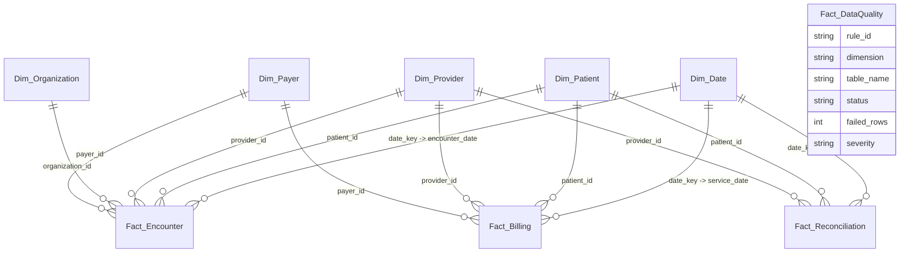

# MedDataIQ — Power BI Implementation & Dashboard Architecture Guide

This comprehensive guide details the design, configuration, star-schema data modeling, and report authoring steps for the **MedDataIQ Healthcare Intelligence & Revenue Integrity** Power BI reporting suite.

---

## 1. System Environment & Prerequisites

### Power BI Desktop Status
> [!NOTE]
> **Power BI Desktop Environment Status**: `PBIDesktop.exe` is **not installed** in this development environment. 
> 
> To run the dashboard interactively:
> 1. Download and install **Microsoft Power BI Desktop** (Free) from the [Microsoft Power BI Download Center](https://powerbi.microsoft.com/desktop/) or the Microsoft Store.
> 2. All required data assets, clean star-schema CSV exports, pre-validated financial totals, theme JSON file, and DAX measures have been built and verified in this repository. You can complete the report build in under 30 minutes following this step-by-step guide.

---

## 2. Data Sourcing & Ingestion

MedDataIQ supports two data connection methods:

### Method A: Star-Schema CSV Import (Recommended — Zero Configuration)
Clean, normalized CSV tables are generated directly from the certified database mart in `data/power_bi_exports/`:
1. Open **Power BI Desktop**.
2. Click **Get Data** > **Text/CSV**.
3. Navigate to `D:\MedDataIQ\data\power_bi_exports\` and import each of the following files:
   - `Dim_Date.csv` (1,461 rows)
   - `Dim_Patient.csv` (1,000 rows)
   - `Dim_Organization.csv` (6 rows)
   - `Dim_Provider.csv` (30 rows)
   - `Dim_Payer.csv` (7 rows)
   - `Fact_Encounter.csv` (5,730 rows)
   - `Fact_Billing.csv` (5,770 rows)
   - `Fact_Reconciliation.csv` (6,010 rows)
   - `Fact_DataQuality.csv` (43 rows)
4. Verify column data types in Power Query and select **Close & Apply**.

### Method B: PostgreSQL Database Connection
To connect directly to the relational database mart:
1. Ensure the PostgreSQL service is active:
   ```powershell
   net start postgresql-x64-18
   ```
2. Click **Get Data** > **PostgreSQL database**.
3. Enter:
   - **Server**: `localhost:5432`
   - **Database**: `meddataiq`
   - **Data Connectivity mode**: **Import** (recommended for DAX performance) or **DirectQuery**
4. Enter credentials (default `postgres` / configured password) and select the tables and view `v_billing_reconciliation_summary`.

---

## 3. Dimensional Data Model (Star Schema)

The MedDataIQ data model utilizes a high-performance star schema centered on clinical and revenue cycle facts, avoiding complex bi-directional cross-filtering or ambiguous loops.

### Entity-Relationship Architecture



### Relationship Matrix

| Primary Key Table (1) | Foreign Key Table (*) | Key Field | Cardinality | Cross Filter Direction |
| :--- | :--- | :--- | :--- | :--- |
| `Dim_Date` | `Fact_Encounter` | `date_key` = `encounter_date` | 1 to Many | Single (`Dim_Date` filters `Fact_Encounter`) |
| `Dim_Date` | `Fact_Billing` | `date_key` = `service_date` | 1 to Many | Single (`Dim_Date` filters `Fact_Billing`) |
| `Dim_Date` | `Fact_Reconciliation` | `date_key` = `service_date` | 1 to Many | Single (`Dim_Date` filters `Fact_Reconciliation`) |
| `Dim_Patient` | `Fact_Encounter` | `patient_id` | 1 to Many | Single |
| `Dim_Patient` | `Fact_Billing` | `patient_id` | 1 to Many | Single |
| `Dim_Patient` | `Fact_Reconciliation` | `patient_id` | 1 to Many | Single |
| `Dim_Provider` | `Fact_Encounter` | `provider_id` | 1 to Many | Single |
| `Dim_Provider` | `Fact_Billing` | `provider_id` | 1 to Many | Single |
| `Dim_Provider` | `Fact_Reconciliation` | `provider_id` | 1 to Many | Single |
| `Dim_Organization` | `Fact_Encounter` | `organization_id` | 1 to Many | Single |
| `Dim_Payer` | `Fact_Encounter` | `payer_id` | 1 to Many | Single |
| `Dim_Payer` | `Fact_Billing` | `payer_id` | 1 to Many | Single |

> [!IMPORTANT]
> **Mark as Date Table**:
> In the Model or Data view, right-click `Dim_Date` > **Mark as date table** > select `full_date`. This enables native Power BI time intelligence while preventing hidden auto-generated datetime hierarchies.

---

## 4. Applying the Futuristic Theme

To replicate the glassmorphic dark design palette of MedDataIQ:
1. In Power BI Desktop, navigate to the **View** ribbon tab.
2. Click the **Themes** dropdown > **Browse for themes**.
3. Select `D:\MedDataIQ\power_bi\meddataiq_theme.json`.
4. The canvas, cards, charts, and grids will immediately adopt:
   - Deep Midnight Navy Canvas (`#060913`)
   - Frosted Dark Navy Visual Containers (`#0D1322` with `#1E293B` borders)
   - Neon Cyan Accent (`#00F2FE`)
   - Electric Blue Accent (`#3B82F6`)
   - Emerald Green Accent (`#10B981`)
   - High-contrast text (`#F8FAFC`, `#94A3B8`)

---

## 5. Report Page Specifications

---

### Page 1: Executive Overview

**Target Persona**: Chief Medical Officer, VP of Revenue Cycle, Chief Financial Officer  
**Objective**: Monitor overall enterprise clinical activity, gross charge volumes, reconciliation health, and total financial exposure at a glance.

#### Wireframe Layout
```
+---------------------------------------------------------------------------------------------------+
|  [Header] MedDataIQ Healthcare Intelligence — Executive Overview               [Date Range Slicer]|
+---------------------------------------------------------------------------------------------------+
| [Card: Total Encounters] [Card: Clinical Cost] [Card: Billed Amount] [Card: Net Var] [Card: DQ]  |
|         5,730                 $4.50M               $4.56M              +$59.6K         90.7%      |
+---------------------------------------------------------------------------------------------------+
| [ Donut Chart: Encounters by Class ]   | [ Clustered Bar: Clinical Cost vs Billed by Month ]     |
|   - Ambulatory (2,374)                 |   - Monthly trend comparison                             |
|   - Outpatient (1,514)                 |   - Highlights margin expansion or contraction           |
|   - Wellness (902)                     |                                                          |
|   - Urgent Care / Inpatient / ER       |                                                          |
+---------------------------------------------------------------------------------------------------+
| [ Table: Top 10 High-Volume Providers ]| [ Stacked Column: Reconciliation Status Breakdown ]      |
|   Provider | Encounters | Billed Amount|   CLEAN_MATCH (76.0%) vs Flagged Discrepancies (24.0%)   |
+---------------------------------------------------------------------------------------------------+
```

#### Visual Configurations
1. **Top Header & Slicers**:
   - Title: `MedDataIQ — Executive Healthcare Intelligence`
   - Slicer 1: `Dim_Date[full_date]` (Between date slider, default `2023-01-01` to `2026-10-01`)
   - Slicer 2: `Fact_Encounter[encounter_class]` (Tile or Dropdown)
2. **KPI Card Strip**:
   - Card 1: `[Total Encounters]` (`5,730`)
   - Card 2: `[Total Clinical Cost]` (`$4,501,299.15`, formatted as `$4.50M`)
   - Card 3: `[Total Billed Amount]` (`$4,560,904.11`, formatted as `$4.56M`)
   - Card 4: `[Net Financial Variance]` (`+$59,604.96`, formatted with positive/negative color alert)
   - Card 5: `[Clean Reconciliation Rate]` (`76.0%`)
3. **Donut Chart — Encounters by Class**:
   - Legend: `Fact_Encounter[encounter_class]`
   - Values: `[Total Encounters]`
   - Data labels: Category + Percent of total
4. **Clustered Column Chart — Clinical Cost vs. Billed by Month**:
   - X-Axis: `Dim_Date[year_month]`
   - Y-Axis: `[Total Clinical Cost]`, `[Total Billed Amount]`
   - Colors: `#3B82F6` (Clinical Cost), `#00F2FE` (Billed Amount)
5. **Horizontal Bar Chart — Top Providers by Billed Amount**:
   - Y-Axis: `Dim_Provider[name]` (Top 10 filtered by billed amount)
   - X-Axis: `[Total Billed Amount]`
   - Tooltip: `[Total Encounters]`, `[Avg Billed per Claim]`
6. **Reconciliation Status Donut**:
   - Legend: `Fact_Reconciliation[reconciliation_status]` (`CLEAN_MATCH` vs `NEEDS_INVESTIGATION`)
   - Values: `[Total Reconciled Records]`

---

### Page 2: Billing Reconciliation Hub

**Target Persona**: Revenue Integrity Directors, Internal Audit, Compliance Officers  
**Objective**: Investigate service-to-billing mismatches, track duplicate claim exposure, unbilled leakage, and prioritize investigation work queues.

#### Wireframe Layout
```
+---------------------------------------------------------------------------------------------------+
|  [Header] Revenue Integrity & Billing Reconciliation Hub                [Audit Category Slicer]   |
+---------------------------------------------------------------------------------------------------+
| [Clean Match]    [Amount Variance]   [Duplicate Claims]   [Unbilled Services]   [Unmatched Bills] |
| 4,567 ($3.45M)   539 (+$58.0K)       240 ($189.3K)        240 ($224.4K)         40 ($36.7K)       |
+---------------------------------------------------------------------------------------------------+
| [ Bar Chart: Discrepancy Breakdown by Category ]  | [ Line Chart: Monthly Net Variance Trend ]    |
|   - CLEAN_MATCH (4,567)                           |   - Shows revenue skew over time              |
|   - AMOUNT_VARIANCE (539)                         |   - Highlights months with extreme leakage    |
|   - TIMING_SKEW (384)                             |                                               |
|   - DUPLICATE_CLAIM (240)                         |                                               |
|   - UNBILLED_SERVICE (240)                        |                                               |
|   - UNMATCHED_BILL (40)                           |                                               |
+---------------------------------------------------------------------------------------------------+
| [ Investigation Queue Grid: High-Risk Flagged Records ]                                           |
|   Recon Key | Service Date | Patient | Encounter Class | Status | Variance ($) | Seq | ...         |
+---------------------------------------------------------------------------------------------------+
```

#### Visual Configurations
1. **Audit Category KPI Strip**:
   - Card 1: `[Clean Reconciliation Count]` (`4,567`) & `[Clean Reconciliation Cost]` (`$3.45M`)
   - Card 2: `[Amount Variance Count]` (`539`) & `[Amount Variance Net Exposure]` (`+$58,004.48`)
   - Card 3: `[Duplicate Claim Count]` (`240`) & `[Duplicate Claim Exposure]` (`$189,343.57`)
   - Card 4: `[Unbilled Service Count]` (`240`) & `[Unbilled Clinical Cost]` (`$224,443.42`)
   - Card 5: `[Unmatched Bill Count]` (`40`) & `[Unmatched Billed Amount]` (`$36,700.33`)
2. **Horizontal Stacked Bar Chart — Reconciliation Audit Categories**:
   - Y-Axis: `Fact_Reconciliation[reconciliation_status]`
   - X-Axis: `[Total Reconciled Records]`
   - Data Colors: Clean Match = `#10B981`, Amount Variance = `#3B82F6`, Duplicate = `#F43F5E`, Unbilled = `#F59E0B`, Unmatched = `#8B5CF6`, Timing Skew = `#06B6D4`
3. **Monthly Variance Trend Line**:
   - X-Axis: `Dim_Date[year_month]`
   - Y-Axis: `[Net Financial Variance]`
   - Markers: Enabled with `#00F2FE` line color
4. **Audit Investigation Queue (Interactive Table)**:
   - Columns:
     - `Fact_Reconciliation[reconciliation_key]`
     - `Fact_Reconciliation[service_date]`
     - `Fact_Reconciliation[encounter_class]`
     - `Fact_Reconciliation[reconciliation_status]`
     - `Fact_Reconciliation[clinical_encounter_cost]`
     - `Fact_Reconciliation[claim_billed_amount]`
     - `Fact_Reconciliation[variance_amount]`
     - `Fact_Reconciliation[claim_seq]`
   - **Conditional Formatting Rules**:
     - Background color on `variance_amount`:
       - `< 0` (Revenue Leakage / Under-billed): Soft Red (`#4C1D24`)
       - `> 0` (Excess Billed / Duplicate): Soft Amber (`#452C06`)
       - `= 0` (Balanced): Soft Slate (`#0F172A`)

---

### Page 3: Clinical Operations & Data Quality

**Target Persona**: Chief Medical Officer, Health Informatics Lead, Data Governance Stewards  
**Objective**: Monitor clinical encounter distribution across providers and evaluate compliance across the 6 healthcare data quality dimensions.

#### Wireframe Layout
```
+---------------------------------------------------------------------------------------------------+
|  [Header] Clinical Operations & Data Quality Governance                 [Dimension / Severity]    |
+---------------------------------------------------------------------------------------------------+
| [DQ Health Index]    [Passed Rules]       [Flagged Rules]     [Active Providers]  [Avg Cost/Enc]  |
|      90.7%               39 / 43               4 / 43                30               $785.57     |
+---------------------------------------------------------------------------------------------------+
| [ Donut / Gauge: Compliance by DQ Dimension ]     | [ Matrix: Provider Workload & Economics ]     |
|   - Completeness (15/15 - 100%)                   |   Provider | Encounters | Avg Cost | Billed   |
|   - Uniqueness (6/7 - 85.7%)                      |   Dr. Adams| 224        | $812     | $185K    |
|   - Validity (4/5 - 80.0%)                        |   Dr. Baker| 210        | $765     | $162K    |
|   - Timeliness (3/4 - 75.0%)                      |   ...                                         |
|   - Consistency (3/4 - 75.0%)                     |                                               |
|   - Referential Integrity (8/8 - 100%)            |                                               |
+---------------------------------------------------------------------------------------------------+
| [ Table: Data Quality Audit Findings & Flagged Rules ]                                            |
|   Rule ID | Dimension | Table | Rule Description | Failed Rows | Severity | Remediation Action  |
+---------------------------------------------------------------------------------------------------+
```

#### Visual Configurations
1. **Governance KPI Cards**:
   - Card 1: `[Data Quality Compliance Rate]` (`90.7%`)
   - Card 2: `[Data Quality Passed Rules]` (`39`)
   - Card 3: `[Data Quality Flagged Rules]` (`4`)
   - Card 4: `[Active Providers]` (`30`)
   - Card 5: `[Avg Clinical Cost per Encounter]` (`$785.57`)
2. **Horizontal Bar Chart — Rule Pass Rate by DQ Dimension**:
   - Y-Axis: `Fact_DataQuality[dimension]`
   - X-Axis: `% of Passed Rules`
   - Target line: `100%`
3. **Provider Operations Matrix**:
   - Rows: `Dim_Provider[name]`
   - Values:
     - `[Total Encounters]`
     - `[Total Clinical Cost]`
     - `[Avg Clinical Cost per Encounter]`
     - `[Total Billed Amount]`
4. **Data Quality Rules Findings Grid**:
   - Filtered to: `Fact_DataQuality[status] = "FLAGGED"`
   - Columns:
     - `Fact_DataQuality[rule_id]`
     - `Fact_DataQuality[dimension]`
     - `Fact_DataQuality[table_name]`
     - `Fact_DataQuality[failed_rows]`
     - `Fact_DataQuality[severity]`
     - `Fact_DataQuality[message]`

---

## 6. Technical Safeguards & Best Practices

### A. Preventing Cost Multiplication on Duplicate Claims
In standard SQL joins or multi-table Power BI models, joining 5,770 claims to 5,730 encounters creates fan-out. The 240 duplicate claims would normally cause the associated encounter clinical costs to be summed twice ($4,501,299.15 + $172,398.24 = $4,673,697.39).
**MedDataIQ Solution**:
- `Fact_Reconciliation` assigns `clinical_encounter_cost` strictly to the primary claim (`claim_seq = 1`).
- For duplicate claims (`claim_seq > 1`), `clinical_encounter_cost` is explicitly set to `$0.00`.
- As verified in `export_validation_summary.json`, `SUM(clinical_encounter_cost)` is **exactly `$4,501,299.15`**, preserving mathematical parity.

### B. Preserving Unbilled and Unmatched Records
- **Unbilled Encounters** (240 rows): Have valid `encounter_id` and clinical cost, but `claim_id = NULL` and billed amount `$0.00`. They represent documented care that was never billed.
- **Unmatched Claims** (40 rows): Have valid `claim_id` and billed amount, but `encounter_id = NULL` and clinical cost `$0.00`. They represent billed amounts without matching EHR encounters.
- Both groups are preserved in `Fact_Reconciliation` and appear transparently across the Power BI report pages.

### C. Refreshing Data
To refresh Power BI after running upstream ingestion or quality scripts:
1. Run data export:
   ```powershell
   python -m src.export_power_bi
   ```
2. In Power BI Desktop, click **Refresh** on the **Home** ribbon.
